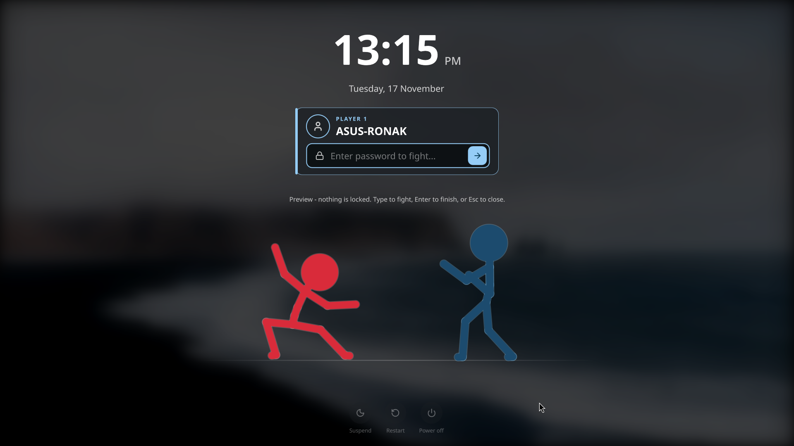

# quickshell-fight-lock

A fighting-game Wayland lock screen for **Quickshell** (Hyprland / `ext-session-lock`), inspired by and adapted from [VirgileHenry/fggreeter](https://github.com/VirgileHenry/fggreeter).

Every keystroke you type lands a strike on the opponent, rapid typing chains combos with impact frames, shockwave ellipses, impact stars, sparks, and camera/UI shake. Submitting your password charges up a windup attack:
- **Correct password** → delivers a dramatic finishing blow, launches the login card upward off-screen, and unlocks your session.
- **Wrong password** → triggers an antagonist counter-attack with strobing impact frames and resets for the next round.



## Features

- **Authentic `fggreeter` choreography** — 24 FPS skeletal animations (`Idle`, `Hit.HighKick`, `Hit.KneeUpercut`, `Hit.LowJab`, `Hit.Smash`, `Hit.Uppercut`, `Windup.Classic`, `Windup.Finisher.Classic`, `Windup.Counter.Classic`) extracted from `fighters.glb` into `fighters-anims.json`, smoothly interpolated at 60 FPS in pure QML `Canvas` (no Bevy or QtQuick3D runtime plugin required).
- **Impact frames & particle FX** — pitch-black/pure-white attacker-defender impact frames, tilted shockwave ellipses, radiating impact stars, directional sparks, drifting embers, and converging windup charge particles.
- **Combo counter & shake** — live hit combo badge (`HIT` / `SUPER COMBO!` / `HYPER COMBO!`), trauma-based camera and login-card shake, and finisher card-launch exit animation.
- **Safe session lock** — uses `WlSessionLock` (`ext-session-lock`) + `PamContext` (`hyprlock` PAM config) with a built-in non-locking `preview` IPC mode for safe testing.
- **Toggleable** — `fightEnabled` can be toggled anytime via IPC without restarting Quickshell.

## Requirements

- [Quickshell](https://quickshell.outfoxxed.me/) (with `WlSessionLock` and `PamContext`)
- Wayland compositor supporting `ext-session-lock-v1` (e.g., Hyprland)
- `/etc/pam.d/hyprlock` (or change `config: "hyprlock"` in `Lock.qml` to `login` or `system-auth`)

## Quick Start (Standalone)

Clone into your Quickshell config directory:

```bash
git clone https://github.com/ronakgupta03/quickshell-fight-lock.git ~/.config/quickshell/fight-lock
```

Start the Quickshell instance:

```bash
qs -c fight-lock -n -d
```

Test it safely **without locking** your session:

```bash
qs -c fight-lock ipc call lock preview
```

Lock your screen for real:

```bash
qs -c fight-lock ipc call lock lock
```

Other IPC commands:

```bash
qs -c fight-lock ipc call lock toggleFight   # Toggle fighting mode on/off
qs -c fight-lock ipc call lock status        # locked | preview | unlocked
qs -c fight-lock ipc call lock endPreview    # Close preview window
```

### Hypridle Integration

In `~/.config/hypr/hypridle.conf`:

```ini
general {
    lock_cmd = qs -c fight-lock ipc call lock lock || pidof hyprlock || hyprlock
    before_sleep_cmd = loginctl lock-session
}
```

## Regenerating Animation Data

`fighters-anims.json` is pre-generated from `VirgileHenry/fggreeter`'s `assets/models/fighters.glb`. To re-extract it yourself (requires Python + `numpy`):

```bash
python3 scripts/extract_fighters.py /path/to/fggreeter/assets/models/fighters.glb fighters-anims.json
```

## Credits & License

- Fighter animations, state machine design, and FX choreography adapted from [VirgileHenry/fggreeter](https://github.com/VirgileHenry/fggreeter) (Apache-2.0).
- Licensed under the [Apache License 2.0](LICENSE).
